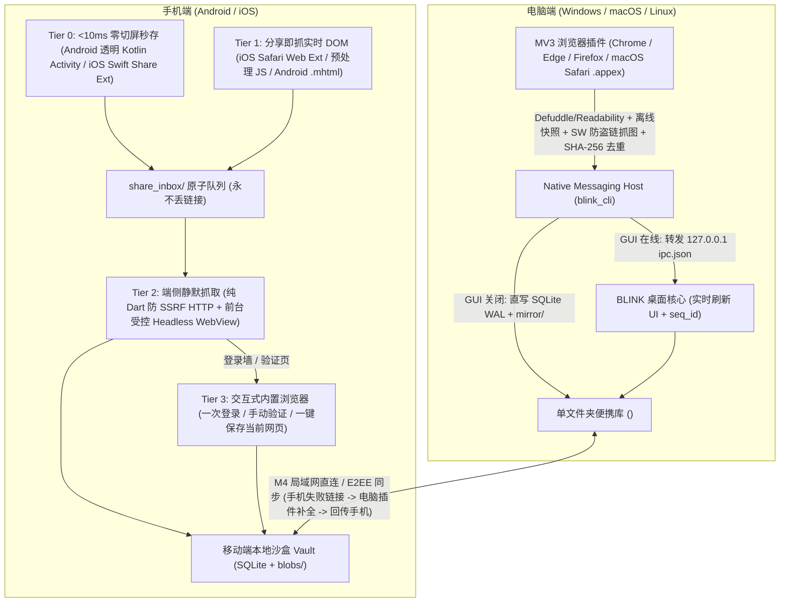

# 网页分享与内容剪藏全端选型研究与工程细化方案（2026-11-28）

本记录按[开源选型规则](../dev-rules/sources-and-safety.md#oss-policy)完成 BLINK 网页分享与离线内容剪藏能力的行业调研、SimpRead（简悦）与主流竞品拆解、`DEC-007` 宽松许可六维查证（查证日期：2026-11-28 UTC+8，7 天依赖冷却基线 `<= 2026-11-21`），并结合 `packages/blink_core`（Schema v2）、`packages/blink_sanitizer`、`packages/blink_cli`、`apps/blink_client/android/.../MainActivity.kt` 与 `apps/blink_client/windows/packaging/blink.nsi` 的代码现状，给出覆盖**电脑端（MV3 扩展 + Native Messaging）**、**手机端（Android / iOS 四层捕获与国内生态适配）**及**双层存储同步**的可落地工程细化方案。

> **决定台账衔接说明**：本方向已获用户认可。因独立笔记化重构分支（[#57](https://github.com/chialecode/blink/issues/57)）尚未合并至 `main` 且已占用 `DEC-033`～`DEC-035`，本次文档提交刻意不修改[有效决定](../decisions.md)以避免编号碰撞；待 `#57` 合并后再统一于 `docs/decisions.md` 补登 **`DEC-036`**。

<a id="overview"></a>
## 1. 结论总览与架构原则

### 1.1 Pocket（2025 关停）失效根因与本地优先价值

Mozilla 已于 **2025 年 5 月 22 日**公告关停 Pocket，**2025 年 7 月 8 日**停止核心应用、扩展与收藏写入，经延期后于 **2025 年 11 月 12 日**关闭最终导出窗口并永久清空云端用户数据。即便是承诺提供“Permanent Library”的付费订阅用户，最终导出物也仅有包含 URL、标题、时间戳、标签与高亮片段的 CSV——**所有历史网页正文与离线快照在关停后彻底蒸发**。

回顾 Pocket 多年使用中最常见的“分享时明明看见正文，打开稍后读却只剩空壳或链接”问题，根源在于其纯云端重抓架构的五类结构性失真：

1. **系统分享仅交出裸 URL + 匿名云端重抓**：Android `ACTION_SEND`、iOS `UIActivityViewController` 及旧 `v3/add` 接口默认不传递源应用的渲染 DOM 或登录 Cookie；云端解析器只能以匿名访客身份重新发起 HTTP 请求。
2. **登录墙、付费墙与内网文档阻断**：知乎全文、Substack、Notion、私有 GitHub 与内网 Wiki 面对无会话请求返回 302 登录跳转、403 或截断预览页。
3. **客户端渲染（CSR / SPA）与懒加载空壳**：静态或受限时限的云端抓取器仅拿到 `<div id="root"></div>` 骨架或未展开的 `data-src` 占位图。
4. **反爬 WAF 拦截与无离线正文的 Web View 退化**：云端机房 IP 与爬虫指纹频繁触发 Cloudflare / WAF 拦截，迫使客户端从“文章视图”退化为实时内嵌网页框架（Web View）——零离线内容落盘，源站 404 或改版即永久失联。
5. **免费层不保底归档**：普通账号本身不保留永久副本，加剧链接腐烂（Link Rot）。

这从反面印证了 BLINK **单文件夹便携知识库（`<BLINK_VAULT_DIR>`）+ 本地内容寻址媒体仓（`blobs/<sha256>`）+ 十年可读开放镜像（`mirror/`）**的长期路线价值（[DEC-022](../decisions.md#dec-022)）。

### 1.2 为什么必须“分端分层”捕获

“能否把用户分享当下亲眼看到的网页完整保存下来”没有跨端银弹，受操作系统沙盒与浏览器扩展机制的硬边界约束，必须按端分层协同：

- **电脑端（Windows / macOS / Linux）**：仅靠桌面 App 拿 URL 直抓**无法覆盖**登录墙、CSR、WAF 与防盗链图；通过 **MV3 浏览器扩展 + Native Messaging 本地桥接（复用 `packages/blink_cli`）**可在用户当前已渲染标签页直接抓取实时 DOM、登录态正文与防盗链图片，且**桌面 GUI 关闭时照样直写 WAL 落盘**，无需像 SimpRead 那样额外常驻独立守护进程。
- **手机端 iOS**：在 **Mobile Safari** 内，随 App 打包且与电脑端共用同一套 TypeScript 核心的 **iOS Safari Web Extension（`.appex`）**可在零切屏状态下直接读取登录态实时 DOM 并由后台 Service Worker 绕过页面 CORS 抓取图片；在 Safari 与 `SFSafariViewController` 内还可通过原生 Swift Share Extension 的 **`NSExtensionJavaScriptPreprocessingFile`** 抓取实时 DOM。而从微信、小红书、知乎、B 站或 Chrome iOS 发起分享时，受 iOS 沙盒限制仅能拿到 URL 或混杂文案。
- **手机端 Android**：系统沙盒严禁任何第三方 App 经 `ACTION_SEND` 交出自身 WebView DOM 或 Cookie；Chrome Android 不支持扩展；**Kiwi Browser 已于 2025 年 1 月停更归档**（代码并入 Edge Android），且 **Firefox Android 与 Edge Android 均不支持 `nativeMessaging`**。因此 Android 最优路线不是强绑浏览器插件，而是 **四层组合拳**：零插件 `<10ms` 透明 Kotlin Activity 秒存（不切屏）→ 纯 Dart 后台抓公开页 → 前台受控 `HeadlessInAppWebView` 抓 SPA → **BLINK 交互式内置浏览器“一次登录 + 一键保存当前网页”** + 跨端同步由电脑插件一键补抓回传。

### 1.3 双层存档形态与核心不变量对齐

| 存档形态 | 优点 | 短板 | 与 BLINK 契合度 |
| --- | --- | --- | --- |
| **A. 仅清晰正文（Readability/Defuddle → AST + `blobs/`）** | 排版舒适、日/纸/夜自适应、`.runes` 划词锚点稳定、FTS5 与外置 AI 语料干净、体积最小 | 算法漏段落/表格或遇到非文章页（看板/文档）时，**原网页 404 后永久不可恢复** | 中（不满足离线重解析保底） |
| **B. 仅整页视觉快照（Single-HTML / MHTML / WARC / PDF）** | 视觉还原度最高 | MHTML 在 Firefox/Safari/iOS 均不受支持且内含脚本；Base64 内联膨胀约 33% 且跨页无法去重；WARC 依赖专用回放器；固定版式难重排、难批注 | 低 |
| **C. 双层存档（采用）：不可变离线零 JS 快照（HTML + `blobs/<sha256>`） + 派生清晰块级 AST** | 兼得抗 404 完整保真与五端原生阅读/批注/检索/AI 体验；图片统一改写为 `blink-blob://<sha256>` 跨页去重；未来升级解析算法可离线重算 AST | 需为外部网页快照补充专用净化策略 `SanitizeProfile.webSnapshot` 与图片引用表 `raw_source_blobs` | **最高（严格契合 `INV-01`、`INV-09`、`INV-13`）** |

全链路严格守卫 BLINK 架构不变量（[系统架构不变量](../design/architecture.md#invariants)）：

- **`INV-01`（原文只读与捕获边界）**：捕获的离线 HTML 快照、`blobs/` 图片字节、原始分享文案 `raw_share_text` 及用户批注归属原文层；`blink clip ingest-native` 为用户主动发起的采集写入，只允许创建 `raw_sources`/`raw_source_chapters`/`raw_source_blobs`/`media_blobs` 或将 `queued`/`failed` 升级为 `ready`，绝不覆盖用户手写 `raw_entries` 或 `raw_annotations`。
- **`INV-03`（`#private` 四层零云端出境）**：`raw_source_blobs` 纳入 `SyncEngine` `normalReferenced` 过滤使 `#private` 网页图片 0 字节发往云中继；WebView 渲染与快照查看严禁外链与脚本；Android 端 `#private` 网页抓取严守单进程 `CookieManager` 隔离红线。
- **`INV-11`（诚实状态与合规零绕过）**：严禁窃取系统浏览器 Cookie 库，严禁绕过 CAPTCHA / 反爬挑战 / 付费墙；受阻时诚实标注 `needs_interactive_clip` 或 `anti_bot_or_paywall`，交给用户本人在内置浏览器或电脑端浏览器插件中合法查看并一键保存。



<a id="simpread-and-peers"></a>
## 2. SimpRead（简悦）深度拆解、竞品横评与 DEC-007 六维查证

### 2.1 SimpRead（简悦）架构深度拆解

| 维度 | SimpRead 实际实现 | 值得 BLINK 借鉴的思路 | 明确短板与不可复用红线 |
| --- | --- | --- | --- |
| **桌面正文提取** | 浏览器扩展内置 **PuRead**（`puread.min.js`）词法解析引擎 + 三级站点适配库（本地规则 → 官方主库 → 社区订阅）+ **SiteEditor** 可视化/表达式选择器（`include`/`exclude`）+ 临时阅读模式与手动框选；提取前解析 `lazyload` 懒图属性并按 `paging` 规则拼接多页文章 | **在当前标签页实时 DOM 上操作**；抽取前先做懒加载属性回填；提供兜底手动框选能力应对复杂页面 | 重度依赖人工维护的站点规则库，普通用户配置负担偏重 |
| **持久化与快照** | 稍后读 2.0 搭配本地离线快照、高亮批注与双链；支持 Chromium `chrome.pageCapture.saveAsMHTML`（MHTML）、离线 HTML + `assets/`、Markdown + `assets/`、PDF/EPUB/PNG | 区分“阅读队列元数据”与“离线快照 + 本地化图片目录”，有效对抗源站 404 | `saveAsMHTML` 仅 Chromium 支持（Firefox/Safari/iOS 不可用）且文件保留原始脚本 |
| **本地桥接（同步助手）** | 独立托盘守护进程 `simpread-sync`（Node.js/Electron），监听 **`http://localhost:7026`** 提供 **HTTP REST + WebSocket** 双向通信及本地 Web 控制台，绕过扩展沙盒写入本地目录（Obsidian/Logseq）并通过 WebDAV/网盘同步 | 证明了“浏览器扩展直写用户自有文件夹、摆脱封闭云锁定”的强需求 | **常驻独立进程**、固定端口 `7026` 易冲突、面临 2025–2026 Chrome LNA 本地网络访问拦截、多组件串联配置链路长（UID + 同步助手 + WebDAV + 第三方插件）、闭源二进制 |
| **移动端现状** | **无官方原生 iOS / Android 客户端**；主要靠 iOS 快捷指令调开放 API（`simpread.pro/@id/add/?token=...`）或转发至 Telegram Bot / 第三方笔记，再经 WebDAV 同步 Markdown 到移动端 Obsidian 阅读 | 无 | 配置门槛高（需付费高级账户 + Token + 中转）；快捷指令仅传 URL 无法离线存图或捕移动端登录 DOM；桌面与移动端体验割裂 |
| **开源状态与许可** | `github.com/Kenshin/simpread` 为 **`GPL-3.0`**，开源停更于 v1.x（`~v1.1.4.6205`，`puread` 为混淆压缩产物）；v2.x 核心、同步助手与开放 API 均为**闭源买断付费** | 仅借鉴产品交互边界 | **⛔ 违反 `DEC-007` 红线，严禁引入、移植或派生任何代码** |

### 2.2 八款主流竞品横向对比与许可审计

> 注：经 2026-11-28 交叉核实，**Kiwi Browser 已于 2025 年 1 月停更归档**，其扩展能力并入 **Microsoft Edge Android**；下表已同步校正移动端扩展支持现状。

| 产品 / 项目 | 桌面捕获机制 | 手机分享捕获机制 | 登录墙 / CSR 能力 | 离线图片与快照保真度 | 本地优先 / 零后端 | 许可证与 `DEC-007` 结论 |
| --- | --- | --- | --- | --- | --- | --- |
| **Obsidian Web Clipper + Defuddle** | MV3 扩展在实时 DOM 跑 `defuddle` → Markdown 经 `obsidian://` URI（长文回退剪贴板） | 仅移动浏览器扩展（iOS Safari / Android Firefox、Edge）；无系统分享接收 | 高（浏览器内实时登录态），但后置下载遇登录图易失真 | **偏低**（默认留外链图 URL，URI 无法传二进制，无视觉快照） | 是（直写本地 Vault） | **`MIT`** — ✅ **允许引入 `defuddle`**（Obsidian 客户端本体闭源） |
| **Readwise Reader** | 浏览器扩展捕获实时 DOM + 图片 + 高亮 | 原生 iOS/Android 分享；iOS Safari 可抓渲染页，其余 App 与 Android 多数传 URL 走云端抓取 | 桌面与 iOS Safari 高；Android 与非 Safari 偏低 | 高（云端归档 + 本地离线缓存） | 否（云端 SaaS） | 闭源 SaaS |
| **Cubox** | 浏览器扩展捕获实时 DOM / 摘录上传云端 | 原生分享 + 微信收藏助手转发（走云端抓） | 桌面正文高但云快照常撞登录墙；手机/微信走云端易受限 | 高（正文 + 网页快照双视图，云端存档） | 否（云端 SaaS） | 闭源 SaaS |
| **SingleFile** | 浏览器扩展序列化实时 DOM，CSS/字体/图内联为 `data:` 单 `.html` | 仅移动浏览器扩展（iOS Safari / Firefox、Edge Android）；无系统分享 | **极高**（完整渲染状态 + 会话内资源） | **视觉最高**，但 Base64 膨胀约 33%、跨页无法去重、难批注与检索 | 是（保存本地单 HTML） | **`AGPL-3.0-or-later`** — ⛔ **严禁引入/移植** |
| **Wallabag** | `wallabagger` 默认发 URL 给 PHP 服务端；可选“从浏览器抓取”上传实时 DOM | 原生 App 分享发 URL 给服务端（官方 `ios-app` 已归档） | 桌面中；手机低（PHP 抓取无 JS 引擎与 Cookie） | 中高（服务端下载图片本地化） | 否（需 PHP/DB 服务端） | 服务端/扩展/归档 iOS 为 `MIT`；**`wallabag/android-app` 为 `GPL-3.0` ⛔** |
| **Omnivore** | 扩展发实时 DOM（云服务已于 2024-11 关停，上游仓库归档） | 原生分享发 URL → 服务端无头浏览器抓取 | 桌面高；手机中（能跑 CSR 但缺登录态） | 中高（清晰正文 + 离线缓存） | 否（多容器重型自托管） | **`AGPL-3.0`** — ⛔ **严禁引入** |
| **Karakeep（原 Hoarder）** | 扩展发 URL 或集成 SingleFile 预抓归档 | 原生分享发 URL → 服务端无头 Chrome + Monolith | 桌面高；手机中（缺登录态与过盾） | 极高（整页归档 + Readability + 截图） | 否（Docker + 无头 Chrome） | **`AGPL-3.0`** — ⛔ **严禁引入**（注：独立 Rust CLI `Y2Z/monolith` 为 `0BSD`） |
| **Readeck** | 官方扩展直接上传渲染后 HTML + 图片至 Go 服务端 | 原生 App 分享发 URL → Go 服务端抓取 | 桌面高；手机中低（不存第三方密码） | 高（独立 HTML + 本地图片 + EPUB） | 否（单二进制服务端） | 服务端 **`AGPL-3.0-only` ⛔**；扩展 **`LGPL-3.0-only` ⛔**（打包 JS 不适用 `DEC-026` 系统动态链接豁免） |

### 2.3 `DEC-007` 宽松许可六维选型查证表与拒绝清单

下表按[开源六维查证规则](../dev-rules/sources-and-safety.md#oss-policy)于 **2026-11-28 UTC+8** 核验（7 天依赖冷却基线 `<= 2026-11-21`；未查实项如实记为 `unknown`）：

| 组件与官方来源 | 评估版本与发布日期（UTC） | 维护状态与冷却期 | 许可证（直接 / 传递依赖） | 五端 / 中文 / 离线适配 | 集成成本、自研边界与结论 |
| --- | --- | --- | --- | --- | --- |
| `defuddle`（`github.com/kepano/defuddle`、`npmjs.com/package/defuddle`） | `0.19.13`（约 2026-11-20，满足 7 天冷却） | 活跃维护（Obsidian Web Clipper 上游提取器） | **`MIT`** / 核心 `defuddle` 包 **0 运行时依赖**（`defuddle/full` 含可选数学依赖，引入前须独立复核） | 运行于扩展内容脚本与移动端 WebView JS 注入，纯离线；对 SPA、代码块、脚注与微信公众号 DOM 结构兼容优于传统 Readability | 极轻无绑定；**✅ 采用（桌面扩展与移动端 WebView 主正文提取器）** |
| `@mozilla/readability`（`github.com/mozilla/readability`、`npmjs.com/package/@mozilla/readability`） | `0.6.0`（2025-03-03，远超 7 天） | 稳定维护（Mozilla 官方） | **`Apache-2.0`** / **0 运行时依赖** | 全浏览器与 WebView 纯离线可用，兼容中文长文 | 极轻成熟；**✅ 采用（`defuddle` 抽取为空或异常时的 A/B 兜底提取器）** |
| `turndown`（`github.com/mixmark-io/turndown`、`npmjs.com/package/turndown`） | `7.2.5`（2026-11-04，24 天） | 活跃维护 | **`MIT`** / 浏览器使用原生 DOM（Node 侧 `@mixmark-io/domino` 为 `BSD-2-Clause`） | 纯离线 DOM → Markdown 转换，支持自定义规则映射 BFM v1 | 仅用于“剪藏为小记/笔记”可选路径；**✅ 采用** |
| `dompurify`（`github.com/cure53/DOMPurify`、`npmjs.com/package/dompurify`） | `3.5.0`（2026-11-22，实现锁定前核验满 7 天冷却） | 活跃维护 | **`MPL-2.0 OR Apache-2.0` 双许可** / 0 运行时依赖 | 仅用于扩展浮层预览纵深防御，纯离线 | **✅ 仅在随包声明中显式选用 `Apache-2.0` 许可分支时放行**（严禁选 `MPL-2.0`）；落库前仍以纯 Dart `packages/blink_sanitizer` 为唯一权威门禁（`INV-13`） |
| `flutter_inappwebview`（`pub.dev/packages/flutter_inappwebview`） | `6.1.5`（已在 [DEC-024](../decisions.md#dec-024) 锁定选型） | 稳定维护 | **`Apache-2.0`** / 全宽松依赖 | Windows / macOS / Android / iOS 四端可用（Linux 仍走 `DEC-026` 独立路径）；提供 `InAppWebView`、`HeadlessInAppWebView`、`CookieManager` | 复用既有选型，零新增 WebView 引擎；**✅ 采用（Surface 2 + 移动端内置浏览器与前台无头抓取）** |
| `package:html`（`pub.dev/packages/html`，Dart 官方） | `0.15.7`（已锁定于 `pubspec.lock`） | 活跃维护 | **`MIT` + `BSD-3-Clause`**（已登记第三方声明） | 五端 + `dart build cli` 全纯 Dart 离线可用 | 零新增包；**✅ 复用（M5 纯 Dart CJK Readability 与 `packages/blink_sanitizer` 底座）** |
| `rrweb-snapshot` / `freeze-dry` | `2.2.0`（2026-10～11）/ `1.0.0`（2022-09 停滞） | 活跃 / 已停滞 | `MIT` / `Unlicense` | `rrweb-snapshot` 输出 JSON AST 而非直出离线 HTML；`freeze-dry` 早于 MV3 SW 与 `adoptedStyleSheets` | **跳过引入**，仅借鉴思路自研 ~300–600 行 `Apache-2.0` MV3 视觉快照内联器 |
| `receive_sharing_intent` / `share_handler`（`pub.dev`） | `1.8.1`～`1.9.0+` / `0.0.25` | 问题积压多 / pre-1.0 | `Apache-2.0` / `MIT` | 两者均会强行拉起 Flutter 全屏界面（破坏零切屏体验），且均缺少 Android `ACTION_PROCESS_TEXT` 划词捕获 | **跳过引入**（遵循 [DEC-032](../decisions.md#dec-032) 零额外插件标准），自研 ~150 行透明 Kotlin `ShareReceiverActivity` 与原生 Swift Share Extension |
| SingleFile、SimpRead、Omnivore、Karakeep、Readeck、Wallabag Android | — | 部分停更/归档或活跃 | **`AGPL-3.0` / `GPL-3.0` / `LGPL-3.0-only`**（SimpRead v2.x 闭源） | — | **⛔ 硬拒绝（违反 `DEC-007` 传染性许可红线，严禁依赖、复制或翻译代码）** |

<a id="data-and-storage"></a>
## 3. 存档形态与核心数据层细化方案

基于对 `origin/main` 代码库中 `packages/blink_core/lib/src/vault/vault_schema.dart`、`packages/blink_core/lib/src/storage/blob_store.dart`、`packages/blink_core/lib/src/sync/sync_engine.dart`、`packages/blink_core/lib/src/mirror/mirror_exporter.dart` 与 `packages/blink_sanitizer/lib/src/models.dart` 的实勘，现有 Schema v2 已预留 `raw_sources`、`raw_source_chapters`、`media_blobs` 与 `raw_entries.capture_origin = 'share_sheet'` + `source_ref_id`，但落地双层网页剪藏前必须在 M5 补齐以下 4 项底层契约。

### 3.1 双层存档落库映射

1. **视觉快照层（不可变原文保底，可选开启）**：
   - 经 `packages/blink_sanitizer`（`SanitizeProfile.webSnapshot`）净化且剥离脚本、将全部图片重写为 `blink-blob://<sha256>` 的离线单文件 HTML，按 `SHA-256` 存入 `<BLINK_VAULT_DIR>/blobs/`，复用 `raw_sources.file_blob_sha256` 指向（该列在现有 Schema v2 中对 `web_article` 原本为 `NULL`，零冗余列；`mime_type = 'text/html; charset=utf-8'`）。
   - 不使用 Base64 内联图片，消除 ~33% 膨胀并实现跨文章同图内容寻址去重。
2. **清晰阅读层（权威阅读/批注/检索/导出正本）**：
   - `raw_source_chapters` 中写入单章 `chapter_id = 'ch-001'`、`ast_version = 1` 双轨 Block AST（`plain_text` + 经 `SanitizeProfile.readingBlock` 净化的 `html_sanitized`），供五端纯 Flutter Surface 1 阅读器、`.runes` 零漂移批注锚点（`INV-10`）、`index/fts.db` CJK FTS5 全文检索与外置 AI MCP 只读工具使用。
   - 未来提取算法升级时，可直接从本地 `file_blob_sha256` 离线重算 `ch-001` 并执行 `INV-10` 三级重锚，无需重新联网抓取可能已 404 的原网址。

### 3.2 `packages/blink_core` Schema v3 DDL 与迁移设计

Schema v2 → v3 迁移严格沿用 `vault_schema.dart` 既有模式：先执行 `VACUUM INTO` 生成迁移前原子热快照（`INV-07`），再在单个 `BEGIN IMMEDIATE` 事务内执行幂等 `migrateMainDatabaseV2ToV3(db)` 并推进 `vault_meta.schema_version = '3'`：

```sql
-- 1. 新增网页/书籍内嵌媒体引用关联表（防 GC 误删 + 精准 #private 云中继过滤）
CREATE TABLE IF NOT EXISTS raw_source_blobs (
  source_id TEXT NOT NULL REFERENCES raw_sources(id) ON DELETE CASCADE,
  blob_sha256 TEXT NOT NULL,
  role TEXT NOT NULL CHECK(role IN ('snapshot_html', 'inline_image', 'cover', 'web_archive', 'attachment')),
  created_at TEXT NOT NULL,
  PRIMARY KEY (source_id, blob_sha256, role)
);
CREATE INDEX IF NOT EXISTS idx_raw_source_blobs_sha
  ON raw_source_blobs (blob_sha256);

-- 2. 扩展 raw_sources 捕获来源与原始分享文本元数据（不重建表，零破坏性向前兼容）
ALTER TABLE raw_sources ADD COLUMN capture_method TEXT NOT NULL DEFAULT 'direct_http'
  CHECK(capture_method IN (
    'direct_http',
    'browser_ext_mv3',
    'ios_safari_ext',
    'ios_share_js',
    'mobile_headless_webview',
    'mobile_interactive_webview',
    'file_import',
    'manual_paste'
  ));
ALTER TABLE raw_sources ADD COLUMN captured_at_ms INTEGER NULL;
ALTER TABLE raw_sources ADD COLUMN raw_share_text TEXT NULL;

-- 3. 补齐 normal_only 章节只读隔离视图（供 M6 ExternalAiRepository 使用，INV-03）
CREATE VIEW IF NOT EXISTS v_normal_chapters AS
  SELECT c.*
  FROM raw_source_chapters c
  INNER JOIN raw_sources s ON s.id = c.source_id
  WHERE s.privacy_level = 'normal' AND s.deleted_at IS NULL;
```

**`ingest_state` 与 `ingest_error` 枚举契约（保持向后兼容）**：

- 现有 `vault_schema.dart` 已约束 `ingest_state IN ('queued', 'parsing', 'ready', 'failed')`。Schema v3 **保留该 4 态枚举**不改写 `CHECK` 约束，避免表重建风险，并把失败与待交互细分收敛至结构化 `ingest_error`：

| `ingest_state` | `ingest_error` 枚举值 | 精确语义与客户端动作 |
| --- | --- | --- |
| `queued` | `NULL` | 0ms 刚落盘等待端侧抓取或排队中 |
| `parsing` | `NULL` | 后台 Isolate 或前台无头 WebView 正在抓取解析 |
| `ready` | `NULL` | 清晰阅读 AST（与可选离线快照）及内嵌图片已本地固化 |
| `failed` | `needs_interactive_clip` | 命中登录墙、微信环境验证（`wappoc_appmsgcaptcha`）、知乎 `40362`、小红书/X 登录墙或纯 CSR 需交互；卡片一键拉起内置浏览器或由桌面插件补全 |
| `failed` | `anti_bot_or_paywall` | 命中硬付费墙或反爬挑战（严守零绕过底线，`INV-11`） |
| `failed` | `ssrf_blocked` | 初始 URL 或任一 302 跳转解析至回环/私网/链路本地/Tailscale IP 被阻断 |
| `failed` | `payload_too_large` / `redirect_limit_exceeded` | 响应超 15 MiB 上限或超过 5 跳重定向 |
| `failed` | `parse_empty` / `network_error` / `unsupported_media` | 正文提取为空、网络超时/404 或非支持媒体类型 |

### 3.3 Blob GC 防误删与 `SyncEngine` 扩展契约

实勘现有代码发现两处关键缺口，必须在 M5 与 Schema v3 同步闭合：

1. **文章插图防 GC 误删（`packages/blink_core/lib/src/storage/blob_store.dart`）**：
   - 现状：`SqliteBlobStore.gcUnreferencedBlobs()` 仅扫描 `raw_entries.{audio_blob_sha256, image_blob_sha256s}`、`raw_sources.{file_blob_sha256, cover_blob_sha256}` 与 `editor_drafts.image_blob_sha256s`，未统计 `raw_source_chapters.ast_json` 与快照 HTML 内的 `blink-blob://<sha256>` 图片。
   - 细化方案：每次写入或升级 `raw_sources` / `raw_source_chapters` 时，在同一写事务内以确定性集合同步更新 `raw_source_blobs`；`gcUnreferencedBlobs()` 增加扫描 `SELECT DISTINCT blob_sha256 FROM raw_source_blobs`，确保在读文章与回收站内文章的所有插图与快照永不被误删，直至永久彻底删除 `raw_sources` 行后由 `ON DELETE CASCADE` 释放引用。
2. **`#private` 网页图片零云中继泄露（`packages/blink_core/lib/src/sync/sync_engine.dart`）**：
   - 现状：`SyncEngine` 的 `normalReferenced` 防御性过滤仅查询 `raw_entries` 与 `raw_sources.{file_blob_sha256, cover_blob_sha256}`。
   - 细化方案：扩展 `normalReferenced` 增加查询：
     ```sql
     SELECT DISTINCT b.blob_sha256
     FROM raw_source_blobs b
     INNER JOIN raw_sources s ON s.id = b.source_id
     WHERE s.privacy_level = 'normal'
     ```
     同时在 `_collectPayloadBlobShas` 中收集 `raw_source` / `raw_source_chapter` OpLog 负载内的 `source_blobs[]` 列表。由此保证：① 常规网页的全部内嵌图片随同步自动上传下载；② 凡 `privacy_level = 'private'` 的网页文章，其离线快照与所有插图在启用“禁止经云中继同步 `#private`”时 **0 字节发往 WebDAV/S3**（`INV-03`）。
3. **补齐 `raw_sources` 状态升级与 `raw_source_chapters` 同步（`sync_engine.dart`）**：
   - 现状：`_applyRawSourceOpInTx()` 对已存在的 `raw_sources` 行仅更新 `reading_progress_json`、`privacy_level`、`deleted_at`，且 `SyncEngine` 尚未处理 `raw_source_chapter` 同步事件。
   - 细化方案：
     - **升级优先合并规则**：对既有 `raw_sources` 行，若对端或本地一方为 `ingest_state = 'ready'` 而另一方为 `queued`/`parsing`/`failed`，则 **`ready` 侧的抓取产物字段**（`title`、`authors_json`、`file_blob_sha256`、`cover_blob_sha256`、`ast_version`、`ingest_state`、`ingest_error`、`capture_method`、`captured_at_ms`）单向晋升胜出，防止旧端回写阅读进度时冲掉已完成抓取的离线正文；若双端均为 `ready`，则按 `(hlc_ts, device_id, client_op_id)` 确定性收敛；`reading_progress_json` 独立按 `hlc_ts` 取最新；`privacy_level` 在并发冲突中继续保持 `private` 恒胜。
     - **新增 `raw_source_chapter` OpLog 实体**：`entity_layer = 'raw'`、`entity_type = 'raw_source_chapter'`、`entity_id = '<source_id>:<chapter_id>'`，payload 携带 `source_id`、`chapter_id`、`order_index`、`chapter_title`、`ast_json`、`plain_text_len`、`ast_sha256` 与 `source_blobs[]`。入库事务幂等 `INSERT ... ON CONFLICT(source_id, chapter_id) DO UPDATE` 并同步更新 `raw_source_blobs` 与隔离 `index/fts.db`（`fts_normal` / `fts_private`）。
     - 该扩展直接打通 **“手机 0ms 秒存受限链接 → 同步到电脑 → 电脑插件补全完整图文 → 自动回传手机离线阅读”** 的跨端闭环。

### 3.4 `packages/blink_sanitizer` 新增 `SanitizeProfile.webSnapshot` 与离线 CSP

现有 `packages/blink_sanitizer/lib/src/models.dart` 提供三个 Profile：`surface1Native`、`surface2Sandbox`（为 AI 卡片强制禁止字面色值 `E_RAW_COLOR_LITERAL`）与 `readingBlock`（适用于清晰正文 AST）。为安全承接外部网页离线视觉快照，新增第四个 Profile **`SanitizeProfile.webSnapshot('web_snapshot')`**（默认 `HtmlProducer.externalContent`）及配套 CSS 上下文 `CssSanitizeContext.webSnapshotStylesheet` / `webSnapshotInlineStyle`：

| 检查项 | `readingBlock`（清晰阅读 AST） | `surface2Sandbox`（AI 整页卡片） | `webSnapshot`（新增：外部网页离线快照） |
| --- | --- | --- | --- |
| `<script>` / `<iframe>` / `<object>` / `<embed>` / `<form>` / `<base>` / `<meta refresh>` / `<foreignObject>` / `on*` | **100% 物理剥离** | **100% 物理剥离** | **100% 物理剥离** |
| 外链 `<link rel="stylesheet">`、`@import`、CSS `url(http/https/...)`（含 `\75 rl` 转义） | **100% 阻断** | **100% 阻断** | **100% 阻断** |
| `` 与 CSS 背景图协议 | 仅 `blink-blob://<sha256>` | `blink-blob://` 与安全栅格 `data:image/*` | 仅 `blink-blob://<sha256>` 与安全栅格 `data:image/(png\|jpeg\|webp\|gif\|avif);base64,...`（**硬拒 `data:image/svg+xml`**） |
| 字面颜色值（`#hex` / `rgb()` / `hsl()`） | 剔除（跟随阅读器主题） | 硬报错 `E_RAW_COLOR_LITERAL`（强制 `var(--blink-*)`） | **允许保留外部网页原静态布局与无害配色**（不触发 `E_RAW_COLOR_LITERAL`） |
| `<blink-*>` 自定义标签 | 仅安全阅读语义，不接受 AI 卡片标签 | 允许 `<blink-ref>` 编译为 `blink-ref://` | **全部剥离**（纯外部静态归档，不混入内部导航协议） |
| 强制离线 CSP 头 | 纯 Flutter 原生渲染（零 WebView） | `default-src 'none'; script-src 'none'; connect-src 'none'; style-src 'unsafe-inline'; img-src blink-blob: data:; font-src 'self' data:` | `default-src 'none'; script-src 'none'; connect-src 'none'; frame-src 'none'; object-src 'none'; base-uri 'none'; style-src 'unsafe-inline'; img-src blink-blob: data:; font-src 'self' data:` |

### 3.5 开放镜像导出对齐（`mirror_exporter.dart`）

扩展 `packages/blink_core/lib/src/mirror/mirror_exporter.dart` 将 `raw_sources(source_kind = 'web_article')` 纳入 5 秒防抖原子增量导出与 `.blink-mirror-manifest.json` 登记（`INV-07`、`INV-12`）：

- 常规文章导出至 `<BLINK_VAULT_DIR>/mirror/markdown/sources/articles/<YYYY-MM-DD>-<slug>-<id8>.md`；
- `privacy_level = 'private'` 文章严格隔离导出至 `0700` 权限目录 `<BLINK_VAULT_DIR>/mirror/markdown/private/sources/articles/<YYYY-MM-DD>-<slug>-<id8>.md`；
- 文件结构：头部轻量元数据区块（标题、原链接、作者、捕获时间、捕获方式、离线状态与可选快照 blob 哈希）→ 由 `raw_source_chapters` AST 确定性生成的标准 GFM 正文（正文图片保留本地 blob 相对/标识说明，避免回填已防盗链的外链 URL）→ 原始分享备注（若有 `raw_share_text`）→ 关联 `raw_annotations` 高亮边注与伴读问答。

<a id="desktop-clipper"></a>
## 4. 电脑端 MV3 浏览器插件与 Native Messaging 本地桥接细化方案

### 4.1 共享扩展包 `packages/blink_clipper_web` 目录与模块职责

新建独立前端扩展目录 `packages/blink_clipper_web/`（Apache-2.0，TypeScript + MV3，不依赖亦不破坏 `packages/*` 纯 Dart 分层 `INV-02`），一套捕获核心同步构建 **Chromium（Chrome/Edge/Brave）**、**Firefox** 与 **macOS/iOS Safari（`.appex`）** 三类目标产物：

```text
packages/blink_clipper_web/
├── package.json                       # 仅锁定宽松许可依赖: defuddle (MIT), @mozilla/readability (Apache-2.0),
│                                      # turndown (MIT), dompurify (显式选用 Apache-2.0)
├── manifests/
│   ├── manifest.chromium.json         # MV3 Service Worker + minimal permissions + optional_host_permissions
│   ├── manifest.firefox.json          # MV3 + browser_specific_settings.gecko
│   └── manifest.safari.json           # Xcode Safari Web Extension (.appex) 共用清单
├── src/
│   ├── content/
│   │   ├── dom_cloner.ts              # 实时 DOM 克隆: 表单实时值、document.styleSheets + adoptedStyleSheets、
│   │   │                              # Open/Closed Shadow DOM (chrome.dom.openOrClosedShadowRoot / Firefox 原生)、
│   │   │                              # 同源/跨源 iframe (allFrames: true + frameId 关联，DRM/沙盒诚实降级)
│   │   ├── lazy_media.ts              # 懒加载属性归一化: data-src(微信)、data-actualsrc(知乎)、data-original、
│   │   │                              # data-lazy-src、<picture><source srcset>、img.currentSrc
│   │   ├── extractor.ts               # defuddle 主提取 + @mozilla/readability 兜底 + 可选 turndown 转 BFM 小记
│   │   └── snapshot_inliner.ts        # 自研 ~300–600 行 Apache-2.0 视觉快照内联器（零 AGPL SingleFile）：
│   │                                  # 剥离 script/on*/base/meta-refresh，内联 CSSOM，图片占位转 blink-blob://
│   ├── background/
│   │   ├── media_fetcher.ts           # SW 侧原图拉取（credentials:'include', cache:'force-cache'）+ 临时 DNR Referer 规则
│   │   │                              # + WebCrypto SHA-256 哈希与去重（严禁 canvas 导出防污染与破坏动图）
│   │   ├── native_bridge.ts           # 持久化 runtime.connectNative() 端口、分块帧状态机与 SW 30s 保活
│   │   └── loopback_fallback.ts       # 可选 Linux Flatpak/Snap 专用独立回环 HTTP 兜底（默认关闭）
│   └── popup/                         # 极简中文确认弹层（清晰正文 / 含原貌快照 / 记为小记 / #private 开关）
└── tests/                             # 静态夹具单测：微信/知乎/SPA/CSS-in-JS/Shadow DOM/防盗链规则清理
```

### 4.2 最小权限、防盗链拉图与自研 Apache-2.0 快照内联器

1. **安装期最小权限 + 按需提权**：
   - 初始 `manifest.json` 仅请求 `activeTab`、`scripting`、`nativeMessaging`，安装时不触发 `<all_urls>` 权限恐吓弹窗与商店深度审查。
   - 用户首次启用“离线保存防盗链图片 / 完整视觉快照”时，再经 `chrome.permissions.request` 按需申请 `optional_host_permissions: ["https://*/*", "http://*/*"]` 与 `declarativeNetRequestWithHostAccess`（Firefox 对应 `declarativeNetRequest` / `webRequest`）。
2. **禁止 `<canvas>` 导图与两级二进制抓图**：
   - 跨域图片无 CORS 头绘制到 `<canvas>` 会污染画布抛出 `SecurityError`，且会破坏原图 `SHA-256` 与动图 GIF/WebP。
   - **正确链路**：Content Script **绝不经 `runtime.sendMessage` 传图片二进制**（规避 64 MiB JSON 序列化膨胀），仅传 `{placeholderId, url, pageOrigin}` 给 MV3 Service Worker。SW 先在同源/允许缓存下以 `fetch(url, {credentials: 'include', cache: 'force-cache'})` 拉取原始字节；遇到 `mmbiz.qpic.cn`、`picx.zhimg.com` 等强校验 `Referer` 的防盗链 CDN，通过 `chrome.declarativeNetRequest.updateSessionRules` 为该次剪藏目标域名临时注册 `modifyHeaders` 规则设置 `Referer: <pageOrigin>/`（限定 `resourceTypes: ['xmlhttprequest', 'image']`），拉取完成后在 `finally` 块**立即移除**临时规则；SW 直接用 `crypto.subtle.digest('SHA-256', buf)` 计算哈希并询问本地 BLINK 缺失清单，**仅上传库中尚未存在的字节块**。
3. **自研 ~300–600 行 Apache-2.0 视觉快照内联器**：
   - 克隆已水合 DOM（同步 `<input>`/`<textarea>`/`<select>` 运行期值），合并 `document.styleSheets` 与 `document.adoptedStyleSheets`（防止 Emotion / styled-components 空 `<style>` 丢样式），将 Open/Closed Shadow Root 序列化为 Declarative Shadow DOM 或扁平子树；剥离全部 `<script>`、`on*`、`<base>`、`<meta http-equiv="refresh">` 与不可达远程 `<iframe>`；将图片重写为占位符由 SW 替换为 `blink-blob://<sha256>`，送入 `packages/blink_sanitizer`（`SanitizeProfile.webSnapshot`）做最终权威净化并注入离线 CSP。

### 4.3 `blink clip ingest-native` 四步分块二进制协议

Native Messaging 采用 Chrome / Edge / Brave / Firefox 通用标准二进制管道 framing：**4 字节宿主字节序 `uint32`（`Endian.host`）长度头 + UTF-8 JSON 载荷**；`stderr` 仅输出脱敏日志。协议充分适应平台限制——Host → Ext 上限 **1 MiB**（仅回轻量 ACK 与缺失哈希列表）、Ext → Host 上限 **64 MiB**（主动按 **512 KiB～768 KiB** 原始字节分块，约 700 KiB～1 MiB Base64 帧），同时持续打开的 `runtime.connectNative()` 端口可天然**保活 MV3 Service Worker 突破 30 秒空闲回收**。

```text
[Browser Ext SW]                                        [blink_cli (ingest-native)]
      │                                                              │
      │── 1. clip.begin (元数据 + blob_manifest[{sha256,size,mime}]) ─>│ 查 media_blobs 去重
      │<── 2. clip.need_blobs (missing_sha256s[], max_chunk_bytes) ───│
      │                                                              │
      │── 3. clip.blob_chunk (仅传缺失图片, 512~768 KiB 分块循环) ────>│ 逐块累加 + 核验 SHA-256 + 原子落 blobs/
      │<── clip.chunk_ack (可选流控确认) ─────────────────────────────│
      │                                                              │
      │── 4. clip.payload + clip.commit (清洗 HTML + 可选快照 + 备注) ─>│ packages/blink_sanitizer 净化 + AST
      │                                                              │ ├─ GUI 在线 -> POST 127.0.0.1 ipc.json
      │                                                              │ └─ GUI 关闭 -> BEGIN IMMEDIATE WAL + mirror/
      │<── 5. clip.committed ({source_id, ingest_state:"ready", ...})─│
```

关键帧契约字段：

- **`clip.begin`**：`protocol_version: 1`、`clip_id`（UUIDv7）、`origin_url`、`title`、`authors[]`、`capture_mode`（`clean_article` | `dual_snapshot` | `bfm_note`）、`privacy_level`（`normal` | `private`）、`source_id_to_enrich`（可选：用于跨端补全手机秒存条目）、`blob_manifest[{placeholder_id, sha256, mime_type, byte_size, width?, height?}]`。
- **`clip.need_blobs`**：`clip_id`、`missing_sha256s[]`、`max_chunk_bytes`（默认 `786432`）。
- **`clip.blob_chunk`**：`clip_id`、`sha256`、`seq`、`total_chunks`、`data_b64`；服务端接收完所有分块后强制校验最终长度与 `SHA-256` 匹配并通过文件头魔数核验，才经临时文件原子写入 `blobs/<sha[0:2]>/<sha[2:4]>/<sha>`（`INV-07`）。
- **`clip.commit`**：`clip_id`、`clean_html`、`snapshot_html?`、`note_md?`、`placeholder_to_sha256{}`、`captured_at_ms`、`capture_method`（`browser_ext_mv3` | `ios_safari_ext`）。
- **无黑窗启动与双模写入**：浏览器调用 Native Host 时清单 `path` 不能附带 CLI 参数（Chrome 传 `argv[1] = chrome-extension://<id>/` 与 `--parent-window=<hwnd>`，Firefox 传 `argv[1] = <manifest.json>`）。Windows 严禁使用 `.bat` 包装（会闪控制台窗口且转义脆弱），应由 `dart build cli` 产出原生可执行体 `blink-native-host.exe`（或 `blink.exe` 识别 `argv[1]` 自动进入 `clip ingest-native` 模式）；写入时复用 BLINK 既有双模协议——探测 OS 运行期 `0600` `ipc.json` 在线则转发桌面单写者刷新 UI，离线则直写 SQLite WAL 与增量镜像后自动退出。

### 4.4 本地桥接方案对比、Chrome LNA 风险与双通道注册

| 桥接方式 | 优点 | 缺陷与 2025–2026 新风险 | BLINK 结论 |
| --- | --- | --- | --- |
| **Native Messaging（`runtime.connectNative` → `blink_cli`）** | OS 标准管道，**零 CORS、零 LNA 弹窗、零防火墙、零配对码**；**桌面 GUI 关闭时仍可落盘**；保活 MV3 SW | 需每用户注册清单；Chrome 主机名禁止连字符；Linux Flatpak/Snap 沙盒受限 | **✅ 首选主桥接**（Win/macOS/Linux Chrome、Edge、Brave、Firefox） |
| **本地 HTTP 回环（`127.0.0.1:<port>`）** | 原生二进制上传，兼容 Flatpak/Snap 沙盒浏览器 | ① **Chrome 141–145+（2025–2026）Local Network Access（LNA）**拆分 `local-network` 与 `loopback-network` 权限，已导致 Zotero Connector（`127.0.0.1:23119`）频发连接拦截；② **与 BLINK `ipc.json` 硬拒 `Origin` 头的防 CSRF 契约直接冲突**（扩展 `fetch` 必带 `Origin: chrome-extension://...`）；③ 桌面关闭时必败 | **仅作 Linux Flatpak/Snap 可选独立兜底**（须与 `ipc.json` 物理隔离：独立端口、固定白名单 `Origin` + 一次性配对令牌、仅 SW 发起请求） |
| **自定义 URI（`blink://`） / 剪贴板 / Bookmarklet** | 零安装或极轻 | Windows `ShellExecute` **32,767 字符（32 KiB）硬截断**、无二进制、弹外部协议框抢焦点；Bookmarklet 被现代网站 CSP `script-src` 拦 | 仅作无插件人工粘贴兜底 |
| **macOS Safari `.appex`** | Safari 原生内嵌 `SafariWebExtensionHandler` + App Group / 本地 IPC，不读 JSON 清单 | 需复用同套 TS 核心打包 Xcode `.appex` 目标 | **✅ macOS Safari 标准路径** |

**双通道 Native Messaging 主机名与免管理员注册（`INV-06`、`INV-12`）**：

- Chrome 强制主机名匹配正则 `^[a-z0-9_.]+$`（**严禁连字符 `-`**），故严格定义为：
  - 正式通道：`io.github.chialecode.blink`
  - 开发通道：`io.github.chialecode.blink_dev`（以下划线替代连字符）
  - 演练测试身份（`blink-test` / `blink-dev-test`）：**绝不写入**宿主浏览器注册表。
- **Windows（直接集成进现有 `apps/blink_client/windows/packaging/blink.nsi`，零管理员权限）**：安装时在 `$INSTDIR\native-messaging\` 写出 Chromium 版（`allowed_origins`）与 Firefox 版（`allowed_extensions`）JSON 清单，并仅写入当前用户 `HKCU` 键（完整卸载时按自有键清除，不碰其他通道）：
  - `HKCU\Software\Google\Chrome\NativeMessagingHosts\<host>`
  - `HKCU\Software\Microsoft\Edge\NativeMessagingHosts\<host>`
  - `HKCU\Software\BraveSoftware\Brave-Browser\NativeMessagingHosts\<host>`
  - `HKCU\Software\Mozilla\NativeMessagingHosts\<host>`
- **macOS / Linux（由 `blink extension install|uninstall` 原子管理）**：
  - macOS：`~/Library/Application Support/{Google/Chrome,Microsoft Edge,BraveSoftware/Brave-Browser,Mozilla}/NativeMessagingHosts/<host>.json`（Safari 走内嵌 `.appex`）。
  - Linux：`~/.config/{google-chrome,chromium,microsoft-edge,BraveSoftware/Brave-Browser}/NativeMessagingHosts/<host>.json` 与 `~/.mozilla/native-messaging-hosts/<host>.json`。

<a id="mobile-capture"></a>
## 5. 手机端（Android & iOS）四层捕获细化方案与国内生态适配

### 5.1 移动系统分享载荷现实矩阵

| 来源 App | 系统分享实际交出的载荷 | 能否在分享瞬间拿源 App 完整 DOM？ |
| --- | --- | --- |
| **iOS Mobile Safari** | `NSURL` + **支持 `NSExtensionJavaScriptPreprocessingFile` 注入 JS 抓实时 DOM** + 用户可选 `com.apple.webarchive` / PDF | **可以**（配合 Safari Web Extension 还可后台无 CORS 抓防盗链图） |
| **iOS `SFSafariViewController`** | `NSURL` + 支持 `NSExtensionJavaScriptPreprocessingFile` | **可以抓 DOM**（跨站图片受页面 CORS 限制需后拉） |
| **Chrome Android** | 默认仅 `text/plain`（URL + 标题）；分享“已下载的离线网页”时经 `EXTRA_STREAM` 传出 `.mhtml`（`message/rfc822` / `multipart/related` / `application/x-mimearchive`） | 默认不能；离线下载页可收到 `.mhtml` |
| **Chrome iOS** | 仅 `NSURL` / `NSString`，**不能可靠触发预处理 JS**（且会隐藏只声明 WebPage 激活规则的扩展） | 不能 |
| **微信（Android / iOS）** | 自研内置浏览器，主菜单无系统一键分享（通常点 `···` → 复制链接 / 在浏览器打开）；iOS 不支持预处理 JS | 不能 |
| **知乎 / 小红书 / B 站 / X** | **混杂营销文案 + 短链的纯文本**（如 `【标题】https://xhslink.cn/...`、`https://b23.tv/...`），零 DOM、零 Cookie | 不能 |

### 5.2 统一 `share_inbox/` 原子落盘队列协议（Android & iOS 同构）

为保证分享扩展 `<10ms` 退出不切屏、不在 iOS 扩展内启动 Flutter 引擎，双端采用完全一致的目录隔离队列协议（`INV-06`、`INV-07`）：

- **队列路径隔离**：
  - Android：`<filesDir>/<channel>/share_inbox/`（`blink` 包名 `io.github.chialecode.blink`、`blink-dev` 包名 `io.github.chialecode.blink.dev`，双风味沙盒物理隔离）。
  - iOS：App Group 共享容器 `group.io.github.chialecode.blink` / `group.io.github.chialecode.blink.dev` 下的 `share_inbox/`。
- **原子落盘规程**：原生接收器将大 HTML、图片或 `.mhtml`/`.webarchive` 流式写入 `share_inbox/<inbox_id>.assets/`，元数据先写 `<inbox_id>.json.part` 并执行 `fsync`/flush 后原子重命名为 `<inbox_id>.json`（绝不向 iOS `UserDefaults` 塞大文本或文件）。主 App 启动或回到前台时扫描全部 `.json`，按 `inbox_id` 幂等事务入库后删除已消费文件（`INV-12`）。

```json
{
  "schema_version": 1,
  "inbox_id": "01937c12-4a20-7c11-8f02-1190c3e40100",
  "received_at_ms": 1795853120000,
  "platform": "android",
  "channel": "blink-dev",
  "source_action": "action_send",
  "url": "https://example.com/post/123",
  "title": "示例文章标题",
  "raw_share_text": "【推荐阅读】示例文章标题 https://example.com/post/123",
  "selected_quote": null,
  "capture_mode": "url_only",
  "html_rel_path": null,
  "archive_rel_path": null,
  "archive_mime": null,
  "asset_manifest": []
}
```

### 5.3 Tier 0 ～ Tier 3 分层捕获设计（Android & iOS）

| 层级 | Android 细化实现 | iOS 细化实现 | 边界与合规保障 |
| --- | --- | --- | --- |
| **Tier 0：`<10ms` 零切屏秒存** | 遵循 [DEC-032](../decisions.md#dec-032) **零第三方分享插件**：扩展现有 `apps/blink_client/android/.../MainActivity.kt`（`io.github.chialecode.blink/platform`）并新增约 150 行透明主题 Kotlin **`ShareReceiverActivity`**（`Theme.Translucent.NoTitleBar`、`noHistory="true"`、`excludeFromRecents="true"`），接收 `ACTION_SEND`、`ACTION_SEND_MULTIPLE`、**`ACTION_PROCESS_TEXT`**（任意 App 划词浮窗一键存摘录）与 `EXTRA_STREAM`（Chrome `.mhtml`/PDF/EPUB/图），`<10ms` 原子落盘 `share_inbox/`、弹原生 Toast（“已存入 BLINK”）后立刻 `finish()` | 原生 Swift **Share Extension**（同时声明 `NSExtensionActivationSupportsWebPageWithMaxCount`、`NSExtensionActivationSupportsWebURLWithMaxCount`、`NSExtensionActivationSupportsText` 及 `.webarchive`/PDF/EPUB UTI，确保 Chrome iOS/社交 App 均可见），流式写 App Group `share_inbox/` 后立刻 `completeRequest()` | 严禁在 iOS Share Extension 内启动 Flutter 引擎（严守 **~120 MiB** 内存红线）；离线亦可 100% 保存链接与原始分享文案（`INV-01`） |
| **Tier 1：分享/点击瞬间抓实时 DOM** | 接收 Chrome Android 离线下载页分享出的 `.mhtml`（`EXTRA_STREAM`）；可选进阶支持 Firefox/Edge Android MV3 扩展经 Web Share API Level 2 `navigator.share({files})` 将捕获包交回 BLINK（因两者均不支持 `nativeMessaging`） | **1A（最强）**：随 App 打包、复用 `packages/blink_clipper_web` TS 核心的 **iOS Safari Web Extension（`.appex`）**——SW 无 CORS 抓登录/防盗链图并经 `sendNativeMessage` **逐张分块**流式写 App Group（规避 ~80–120 MiB 扩展 OOM），零切屏完成；**1B**：Share Extension 配置 **`NSExtensionJavaScriptPreprocessingFile`**（覆盖 Safari 与 `SFSafariViewController` 实时 DOM，避免巨型 `outerHTML` 触发看门狗超时）+ 接收 `.webarchive` | iOS Mobile Safari 达到与电脑端同级的登录态图文离线捕获；零跨 App 窃取 Cookie |
| **Tier 2：端侧静默抓取** | **2A**：`packages/blink_core` 纯 Dart 防 SSRF HTTP + CJK Readability（后台 `Isolate` / `WorkManager` 安全）；**2B**：复用 `flutter_inappwebview 6.1.5` 的 `HeadlessInAppWebView` 渲染纯 CSR/SPA 并注入 `defuddle`/`@mozilla/readability` | **2A**：同源纯 Dart 防 SSRF HTTP + CJK Readability；**2B**：复用 `flutter_inappwebview 6.1.5` 的 `HeadlessInAppWebView` 渲染纯 CSR/SPA | **硬约束**：① `HeadlessInAppWebView` 仅在 App **前台活跃态**以 **10–15s 硬超时**运行并强制 `.dispose()`（严禁在 Android `WorkManager`/后台 Isolate 调用）；② **补齐 WebView 层 SSRF/Scheme 守卫**：加载前预校验 `http://`/`https://` 与 DNS 非私网 IP，且在 `shouldOverrideUrlLoading` / `shouldInterceptRequest` 硬拦 `file://`、`content://`、`127.0.0.0/8`、`::1`、RFC1918、`169.254.0.0/16`、`100.64.0.0/10` 防探测本机同步/IPC 端口 |
| **Tier 3：交互式内置浏览器与跨端补全** | **3A**：卡片一键唤起 BLINK 自有 **`InAppWebView`**（“一次登录 + 随时一键保存当前网页”），用户自己完成登录或人机验证后点“保存当前网页”经 `evaluateJavascript` 抽实时 DOM 与会话图片；**3B**：App 内用户主动触发的剪贴板链接快捷栏；**3C**：M4 同步至电脑端由浏览器插件一键补抓回传 | 同左（**3A** 内置浏览器 + **3B** 主动触发剪贴板快捷栏，绝不静默轮询 iOS 剪贴板 + **3C** 桌面插件补全回传）；原生 `saveWebArchive`（`.mht`）/`createWebArchiveData`（`.webarchive`）仅作可选辅助原件导出 | **Android `#private` CookieManager 单例安全红线（`INV-03`）**：iOS 支持每实例 `WKWebsiteDataStore.nonPersistent()`，但 Android `android.webkit.CookieManager` 是**进程级全局单例**，盲用 `incognito: true` 可能清空用户正常登录态或造成 `#private` 泄漏；在 `SPK-WC-02` 实测确认 AndroidX WebKit 多 Profile（`WebViewCompat.setProfile`）隔离前，禁止 `#private` 网页共享普通 WebView 会话 |

### 5.4 国内主流超级 App 与 X 分享适配细则

| 平台 | 分享与反爬特征 | BLINK 工程处理策略 |
| --- | --- | --- |
| **微信公众号（`mp.weixin.qq.com`）** | 主菜单无一键系统分享；图片用 `data-src` 存于 `mmbiz.qpic.cn` 且严查 `Referer` 防盗链；偶发 `wappoc_appmsgcaptcha` 环境验证页 | ① App 内提供**用户主动点击触发的剪贴板链接快捷栏**（不静默读 iOS 剪贴板）；② 抓取前统一展开 `data-src`，下载图片时使用 `Referer: https://mp.weixin.qq.com/`（或空 Referer）固化进 `blobs/`，绝不留外链；③ 识别验证页后标 `needs_interactive_clip`，路由至内置浏览器由用户手动验证并一键保存 |
| **知乎（`zhihu.com` / `zhuanlan`）** | 分享含标题噪声；匿名 HTTP 抓取频繁触发 `code: 40362` 风控 | 清洗提取规范 URL 并保留 `raw_share_text`；遇 `40362` 诚实标 `needs_interactive_clip`，经内置浏览器“登录一次”一键保存或同步电脑插件补抓 |
| **小红书（`xhslink`）** | 营销文案混杂短链，且短链**同时存在 `xhslink.com` 与 `xhslink.cn`**（iOS 高频出现 `.cn`）；302 展开后含时效性 `xsec_token` 参数且为重度 CSR + 强登录墙 | URL 提取正则强制匹配 `xhslink\.(?:com\|cn)`；完整保留原始分享文案（`INV-01`）；展开短链经 SSRF 校验并保留必要参数，正文交由内置浏览器或桌面插件补抓 |
| **B 站（`b23.tv`）** | 分享格式为 `【标题】 https://b23.tv/...`，302 展开后带 `spm_id_from`、`vd_source`、`share_source` 等追踪参数 | 经 SSRF 守卫展开短链并剥离追踪参数，再抓取专栏/动态正文或摘要 |
| **X / Twitter（`x.com` / `t.co`）** | 纯 CSR SPA + 强登录墙 | 可选调用公开 `https://publish.x.com/oembed` 获取基础作者与摘录元数据；完整长帖与媒体经 iOS Safari 扩展、内置浏览器或电脑插件捕获 |

<a id="ux-spikes-roadmap"></a>
## 6. 界面去黑话文案契约、原型验证 Spike 与分阶段实施拆解

### 6.1 界面去黑话文案契约

对齐笔记化体验重构（[#57](https://github.com/chialecode/blink/issues/57)）的界面去黑话原则，所有面向用户的网页剪藏与分享文案一律使用直觉化词汇，不暴露内部表名、协议名或枚举码：

| 内部技术概念 | 对外用户界面中文文案 |
| --- | --- |
| `raw_sources(source_kind='web_article')` 模块入口 | **网页收藏 / 稍后读** |
| `ingest_state = 'ready'` 且含本地图片 | **已离线保存（含图片）** |
| `ingest_state = 'queued'` / `'parsing'` | **已保存链接 · 正在离线整理正文…** |
| `ingest_state = 'failed'` + `needs_interactive_clip` | **仅保存链接 · 点此在内置浏览器打开并保存** |
| `ingest_state = 'failed'` + `anti_bot_or_paywall` | **该网页需要登录或验证 · 点此在内置浏览器打开** |
| 切换 `file_blob_sha256`（`SanitizeProfile.webSnapshot`）查看 | **查看网页原貌（离线）** / **切回清晰阅读** |
| 分享或剪藏时同时创建带 `source_ref_id` 的 `raw_entries` | **同时记一条小记** |
| 电脑端发现来自手机的待补全受限链接 | **有 N 篇来自手机的网页待补全 · 在浏览器中打开保存** |

### 6.2 四项前置原型验证 Spike（`SPK-WC-01` ～ `SPK-WC-04`）

未实测前不作主观假设，按阶段前置执行以下四项静音有界原型验证（并同步登记于[路线与验收 `OSS-005`](../delivery/roadmap.md#oss)）：

| 编号 | 验证目标与未知假设 | 验证时机与通过标准 |
| --- | --- | --- |
| **`SPK-WC-01`** | **Windows `dart build cli` 二进制管道帧实测**：验证 Dart `stdin`/`stdout` 在 Windows Native Messaging 管道下是否存在文本模式 CRLF 转义破坏 4 字节 `uint32` 长度头，以及 10 MiB 分块图文传输的内存与耗时 | M6 开工前；Windows 端使用模拟浏览器管道进程往返发送含 `0x0A`/`0x0D` 字节长度头的分块载荷，零帧损坏且 `SHA-256` 100% 匹配 |
| **`SPK-WC-02`** | **Android `#private` WebView 多 Profile 隔离审计（衔接 `SPK-06`）**：验证 AndroidX WebKit `WebViewCompat.setProfile` 在目标 Android 版本上能否独立隔离 `#private` Cookie、缓存与存储且不影响用户普通登录会话 | M5 移动端 WebView 接入前；实机/模拟器验证写入 `#private` Profile 后普通 Profile 读不到其 Cookie，销毁后无磁盘残留；若目标系统版本不支持则将 Android `#private` 网页剪藏锁定为无 Cookie 纯 Dart HTTP 或手动粘贴 |
| **`SPK-WC-03`** | **Linux Flatpak / Snap 浏览器 Portal 与可选独立回环 HTTP 兜底实测**：验证 `org.freedesktop.portal.WebExtensions` 跨发行版可靠性及独立于 `ipc.json` 的回环 HTTP 兜底（固定 `Origin` 白名单 + 一次性配对码） | M6/M7 Linux 适配前；确认常规桌面浏览器 Native Messaging 零弹窗可用，沙盒浏览器在显式开启独立兜底后不破坏 `ipc.json` 零 `Origin` 约束 |
| **`SPK-WC-04`** | **Safari 闭合 Shadow DOM 与 iOS 扩展内存水位实测**：确认 iOS/macOS Safari 内容脚本 Closed Shadow Root 边界，以及 iOS Safari Web Extension / Share Extension 逐图分块落盘在 ~80–120 MiB 红线下的峰值内存 | M7 苹果生态开工前；含 20 张高分辨率图的合成页面在 iOS 真机/模拟器不触发 `EXC_RESOURCE` 内存查杀 |

### 6.3 M5 / M6 / M7 分阶段实施拆解

| 阶段 | 核心交付模块与工程任务 | 关联验收与用户价值 |
| --- | --- | --- |
| **Phase 1（M5 核心）** | ① `packages/blink_core` Schema v3 迁移（`raw_source_blobs`、`raw_sources` 捕获元数据、`v_normal_chapters`）；② 补齐 `SqliteBlobStore.gcUnreferencedBlobs()` 与 `SyncEngine`（`normalReferenced` `#private` 过滤、`raw_sources` 升级合并、`raw_source_chapters` 同步）；③ `packages/blink_sanitizer` 新增 `SanitizeProfile.webSnapshot` 与离线 CSP；④ `mirror_exporter.dart` 导出 `mirror/markdown/sources/articles/` 与 `0700 private/`；⑤ 纯 Dart 防 SSRF HTTP + CJK Readability（含微信 `data-src`/防盗链图本地化与 `xhslink.(com\|cn)`/`b23.tv` 清洗）；⑥ Android 零插件透明 Kotlin `ShareReceiverActivity`（`ACTION_SEND`/`ACTION_PROCESS_TEXT`/`EXTRA_STREAM`）+ `share_inbox/` 队列；⑦ `flutter_inappwebview 6.1.5` **交互式内置浏览器“一次登录 + 一键保存”** + 前台受控 `HeadlessInAppWebView`（附 SSRF/Scheme 拦截与 `SPK-WC-02`） | 对齐 `AC-06`；Android 与全端即刻拥有 Pocket 零切屏秒存 + 公开/公众号/登录墙页面高成功率离线保存图文 |
| **Phase 2（M6 协同）** | ① 完成 `SPK-WC-01` 并新建共享 MV3 扩展包 `packages/blink_clipper_web`（`defuddle` MIT + `@mozilla/readability` Apache-2.0 + 自研 Apache-2.0 快照内联器 + SW 防盗链 DNR `Referer` 抓图 + SHA-256 去重）；② `packages/blink_cli` 新增 `blink clip ingest-native`（四步分块协议，复用 `ipc.json` 在线刷新与冷 WAL 落盘）及 `blink extension install\|uninstall`；③ 集成进 `apps/blink_client/windows/packaging/blink.nsi` 自动注册与卸载 Windows HKCU 双通道 Native Messaging 主机（`io.github.chialecode.blink` / `blink_dev`）；④ 打通“手机待补全链接 → 电脑插件一键补抓 → 自动回传手机离线阅读”闭环 | 电脑端 Chrome/Edge/Firefox 拥有实时 DOM、登录态与离线视觉快照剪藏能力，且零额外常驻同步助手进程 |
| **Phase 3（M7 苹果生态与进阶）** | ① 完成 `SPK-WC-04` 并交付原生 **iOS Swift Share Extension**（App Group `share_inbox/`、`NSExtensionJavaScriptPreprocessingFile`、`.webarchive`）；② 将同一套 `packages/blink_clipper_web` TS 核心打包为 **iOS & macOS Safari Web Extension（`.appex`）**；③ Surface 2 离线网页原貌快照查看器（基于 `SanitizeProfile.webSnapshot`）；④ 可选进阶：Linux Flatpak/Snap 独立回环 HTTP 兜底（`SPK-WC-03`）与 Firefox/Edge Android 扩展 `navigator.share({files})` 联动 | iOS/macOS Safari 获得与桌面端同级的免切屏登录态抓取，达成完整五端离线剪藏闭环 |

### 6.4 核查信息来源

- **Pocket 关停与导出机制**：Mozilla Support 官方公告（`https://support.mozilla.org`，2025-05-22 公告、2025-07-08 停服、2025-11-12 导出截止）
- **SimpRead（简悦）**：`https://github.com/Kenshin/simpread`（`GPL-3.0`，停更于 v1.x）、`https://simpread.pro`、`https://simp.red`
- **宽松许可解析与转换库**：`https://github.com/kepano/defuddle`（`MIT`）、`https://github.com/obsidianmd/obsidian-clipper`（`MIT`）、`https://github.com/mozilla/readability`（`Apache-2.0`）、`https://github.com/mixmark-io/turndown`（`MIT`）、`https://github.com/cure53/DOMPurify`（`MPL-2.0 OR Apache-2.0`，显式选用 `Apache-2.0`）
- **Copyleft 风险核查来源**：`https://github.com/gildas-lormeau/SingleFile`（`AGPL-3.0-or-later`）、`https://github.com/wallabag/android-app`（`GPL-3.0`）、`https://github.com/omnivore-app/omnivore`（`AGPL-3.0`，已归档）、`https://github.com/karakeep-app/karakeep`（`AGPL-3.0`）、`https://codeberg.org/readeck/readeck`（服务端 `AGPL-3.0-only`、扩展 `LGPL-3.0-only`）
- **浏览器扩展与本地桥接规范**：Chrome Extensions 文档（Native Messaging 1 MiB/64 MiB 限制与主机名正则、MV3 Service Worker 保活、`declarativeNetRequest`、`chrome.dom`、`pageCapture`、2025–2026 Chrome 141–145+ Local Network Access `local-network`/`loopback-network`）、MDN WebExtensions Native Messaging 与 Web Share API Level 2
- **移动端原生能力与插件**：Apple Developer 文档（`NSExtensionJavaScriptPreprocessingFile`、Safari Web Extensions `sendNativeMessage`、`WKWebView.createWebArchiveData`、App Groups）、`https://pub.dev/packages/flutter_inappwebview`（`Apache-2.0`）、`https://pub.dev/packages/receive_sharing_intent`、`https://pub.dev/packages/share_handler`
